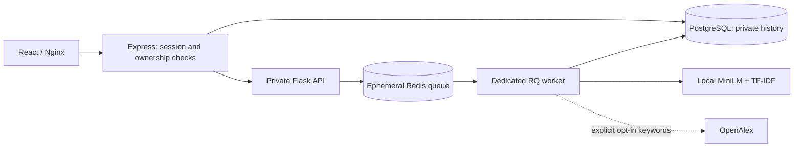

# Paperlane — Research Paper Analyzer

A private manuscript-writing assistant and publication-discovery application. Upload a PDF to inspect writing metrics, extract a summary, find related literature, and match publication venues. It does **not** assess scientific validity, originality, research rigor, plagiarism, or acceptance probability.

Browse the venue directory without uploading, switch between list/card views, and filter by reported publication fees or a same-currency APC budget. See [Paperlane and fee provenance](docs/PAPERLANE.md) for source coverage, refresh instructions and pricing limitations.

## Start with Docker

Requires Docker Compose and Node for the one-time secret generator:

```sh
node scripts/setup-env.js
docker compose up --build
```

Open http://localhost:3000. Startup applies Prisma migrations before starting the API. Only the frontend is published, on the host loopback interface. PostgreSQL, Redis, Flask and Node are private to the Docker network. The first image build installs the CPU embedding model and can take several minutes.

To populate the local paper corpus:

```sh
docker compose exec flask python seed_life_science_data.py
```

Seeding queries OpenAlex with generic subject terms, not uploaded manuscripts. Configure `OPENALEX_API_KEY` if needed by your OpenAlex account. Without a seeded corpus, local paper search explains that no reference corpus is available; venue matching still uses the included CSV dataset.

For a smaller lexical-only installation, set both `INSTALL_SEMANTIC_MODEL=false` and `SEMANTIC_SIMILARITY_ENABLED=false` in `.env` before building. The UI reports the matching method.

## How it works



- PDFs are checked for a PDF signature, size, page count and text limits. Extraction happens in a worker with a timeout.
- Writing metrics include word/sentence estimates, approximate English Flesch Reading Ease, headings and citation markers. There is no fabricated overall quality score.
- Summaries are extractive. Matching uses a longer abstract/section excerpt, not just the displayed summary.
- Related-paper retrieval combines local MiniLM embeddings and TF-IDF across the bounded local corpus, avoiding a keyword-only candidate gate. Token-aware overlapping chunks reduce truncation and document batches bound memory. Corpus embeddings are cached only for the lifetime of the inference process.
- Venue data is normalized once. Open-access, active status, Medline, coverage, type, publisher and subject constraints are strict filters. Ranking uses title/subject relevance, without publisher-prestige bonuses.
- External OpenAlex manuscript searches are off unless the uploader explicitly enables them for that analysis.

## Privacy and retention

- Browser authentication uses HttpOnly, SameSite cookies. Production cookies also require HTTPS.
- Every job has an immutable owner recorded before enqueueing. Guest history is isolated by signed session, not shared or identified by IP.
- IP-derived HMAC values are used only for atomic guest quotas. Clearing cookies does not reset that quota. Users behind a shared public IP share the guest allowance.
- Account profiles and guest-quota counters have a separate lifetime from manuscript records; manuscript expiration does not delete accounts or reset the guest allowance.
- Redis receives raw upload bytes under a short-lived key, not as RQ job arguments. They are removed after processing; queued, killed or abandoned uploads expire within 15 minutes.
- Private results/matching excerpts expire in Redis after the configured retention period. PostgreSQL rows are inaccessible at expiration and cleaned every minute while the backend runs. Default retention is 24 hours. Queue processing can shift the Redis storage expiry slightly later than submission time.
- Deleting an analysis cancels work where possible and removes its private job/cache/history data. Tombstones prevent late workers from repopulating the shared analysis cache.
- Redis persistence is disabled in Compose. Database backups and infrastructure logs remain the deployment operator's responsibility; configure their retention separately.
- Manuscript text is not printed to application logs. External-search failures do not log keyword-bearing URLs.

## Configuration

See `.env.example`. Generate distinct random `JWT_SECRET`, `INTERNAL_API_TOKEN` and `POSTGRES_PASSWORD` with `scripts/setup-env.js`; existing `.env` files are preserved. Do not use production secrets in test environments.

Useful settings: `RETENTION_HOURS` (1–168), `ANALYSIS_JOB_TIMEOUT_SECONDS` (default 300), `MAX_QUEUED_JOBS` (100), `OCR_ENABLED` (false), `SEMANTIC_SIMILARITY_ENABLED` (true), and `OPENALEX_API_KEY`.

OCR is optional: the Python image includes Tesseract English. Set `OCR_ENABLED=true` to try OCR on pages with little extracted text. OCR can be slow and remains subject to the job timeout. It is not enabled or tested against real scanned documents by default.

For public deployment: terminate HTTPS at a trusted proxy, set `NODE_ENV=production`, set the exact `ALLOWED_ORIGINS`, and explicitly configure trusted proxy addresses. Nginx replaces incoming forwarding headers. If adding another upstream proxy, configure trusted real-IP handling there; otherwise guest quotas may group all requests under the proxy address. The supplied in-memory request limiter assumes one Node API instance; use a shared limiter before scaling horizontally.

## Model setup and evaluation

The pretrained model is `sentence-transformers/all-MiniLM-L6-v2`, loaded from local safetensors. `models/manifest.json` pins the downloaded revision. No remote model code is trusted and inference never downloads weights.

```sh
pip install -r requirements.txt
pip install torch==2.9.0 --index-url https://download.pytorch.org/whl/cpu
pip install -r requirements-ml.txt
python scripts/download_model.py
python scripts/evaluate_retrieval.py
python scripts/evaluate_candidate_recall.py
```

See [model details and limitations](docs/MODEL_CARD.md) and the [evaluation artifact](docs/retrieval-evaluation.json). If the model is absent or fails, lexical matching continues with an explicit warning. The old `model.pkl` is retained as an unused legacy artifact; no production code unpickles it.

## Tests

```sh
python -m pytest -q
cd backend
npm ci
npm test
npx prisma validate
cd ../frontend
npm ci
npm test -- --watchAll=false
npm run build
```

Prisma validation needs `DATABASE_URL`. CI also starts disposable PostgreSQL, Redis, Flask, Node and an RQ worker, applies migrations, and runs `scripts/integration_smoke.py`. Never run that script against production: it creates guest records and consumes test quotas. RQ production workers run in Linux/Docker, not native Windows.

## Migration notes

The private-analysis migration adds ownership, state, results and expiration columns. Existing records lack trustworthy job-owner metadata and expire immediately; normal cleanup removes them. Back up an existing database and review this behavior before upgrading. The legacy synchronous `/predict` route returns 410; use `/api/analyze` and `/api/status/:jobId`.

See [the implementation and verification report](docs/IMPLEMENTATION_REPORT.md) for the changes and remaining validation limits.

## License

The original project license remains in `LICENSE`. Third-party libraries, the embedding model and source datasets retain their respective licenses and terms.
